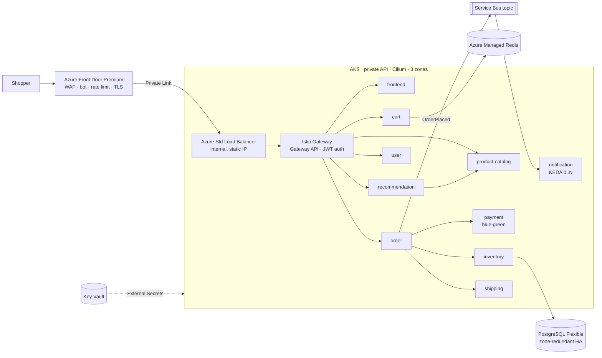

# ShopSphere: production-grade e-commerce platform on Azure

A complete, end-to-end reference implementation: **10 polyglot microservices**
built by **GitHub Actions** into signed, multi-stage container images, deployed by
**GitOps (Argo CD)** to a hardened **AKS** cluster provisioned with **Terraform**,
exposed through **Azure Front Door + WAF → Private Link → internal Azure Load
Balancer → Istio (Gateway API)**, released with **canary and blue-green**
(Argo Rollouts, metric-driven auto-rollback), observed with
**Prometheus / Grafana / Loki / Tempo**, and operated with tested **Bash** tooling.

> Interview prep lives in [`docs/INTERVIEW-GUIDE.md`](docs/INTERVIEW-GUIDE.md).
> Architecture and trade-offs: [`docs/ARCHITECTURE.md`](docs/ARCHITECTURE.md).
> Operations: [`docs/RUNBOOK.md`](docs/RUNBOOK.md).



## The services

| Service | Language | Release strategy | Interesting bits |
|---|---|---|---|
| frontend | JS SPA on nginx-unprivileged | canary | static build stage, CSP headers, SPA fallback |
| product-catalog | Go (stdlib only) | canary | zero deps, distroless/static, ~10 MB image |
| cart | Node 24 / Express 5 | canary | Azure Managed Redis, readiness ≠ liveness |
| order | Java 21 / Spring Boot 3.5 | canary | checkout saga, virtual threads, Service Bus publisher, layered jar |
| payment | Go | **blue-green** | idempotency keys, fault injection to demo auto-rollback |
| shipping | Go | canary | latency injection to demo p95 analysis failing |
| user | Node 24 | canary | RS256 JWT issuer + JWKS used by the gateway |
| inventory | Python 3.13 / FastAPI | canary | PostgreSQL, atomic reservations, PreSync migration Job, CronJob |
| recommendation | Python / FastAPI | rolling | graceful degradation + fallback metric |
| notification | Python worker | rolling + KEDA | Service Bus consumer, scale to zero, workload identity |

Every service: `/healthz`, `/readyz`, `/metrics`, JSON logs, graceful SIGTERM
drain, non-root, read-only root FS, unit tests in the Dockerfile `test` stage.

## Repository map

```
apps/<service>/                 code + multi-stage Dockerfile (+ test stage)
deploy/charts/microservice/     ONE golden-path Helm chart used by all services
gitops/
  apps/<service>/values.yaml    what the service is (team-owned)
  envs/<env>/apps/<svc>.yaml    what runs where (image digest; CI bumps this)
  cluster-config/               Kustomize base + overlays (mesh, gateway, policy, quotas)
  platform/                     add-on versions (components.yaml) + Helm values
  clusters/<env>/               GENERATED Argo CD apps (scripts/ops/render-cluster-apps.sh)
  bootstrap/                    Argo CD install values + root app-of-apps
infra/terraform/
  modules/                      network, aks, acr, keyvault, data, edge, workload-identity, jumpbox
  stacks/platform/              root module; envs/<env>.tfvars + backend config
  stacks/github/                GitHub org/repo settings as code (rulesets, environments)
  examples/import-clickops/     bringing portal-created resources under Terraform
.github/
  workflows/                    ci, _build-service (reusable), promote, terraform(+apply, drift),
                                security (CodeQL + dependency review), post-deploy
  actions/                      composite actions: detect-changes, setup-k8s-tools
scripts/
  lib/common.sh                 logging, retry, locking, dry-run (shared by all scripts)
  bootstrap/                    tfstate backend, GitHub OIDC identities, cluster handover
  linux/                        hardening, runner install, health checks, Postgres backups
  ops/                          smoke tests, PLS approval, key rotation, TF->GitOps values
  ci/                           promotion planning, GitOps bump, drift issues, k8s validation
  tests/                        bats unit tests
```

## Run it locally

```bash
docker compose up --build        # http://localhost:8080
make test                        # unit tests of all 10 services (Dockerfile test stages)
make lint validate               # shellcheck, yamllint, actionlint, bats, helm+kustomize+kubeconform
```

## Run without Azure (simulation mode)

Until you set the repository variables `ACR_DEV_LOGIN_SERVER` and
`AZURE_TENANT_ID`, GitHub Actions runs everything that doesn't need a cloud:
lint, unit tests, image builds, Trivy scans, SBOMs, Helm/Kustomize/kubeconform
validation, `terraform validate` and `terraform test`. Push, promote, plan,
apply and drift jobs are skipped. Keep the repo **public** so code scanning
(CodeQL, Trivy SARIF) and environments work on GitHub's free plan.

## Stand it up in Azure (order matters)

1. `scripts/bootstrap/tf-backend.sh --subscription <sub>`: state storage (the only scripted infra)
2. `scripts/bootstrap/github-oidc.sh --repo org/shopsphere --env dev --subscription <sub>`: OIDC identities
3. `terraform -chdir=infra/terraform/stacks/github apply`: rulesets, environments, variables
4. Merge to `main` → `terraform.yml` applies `stacks/platform` for dev (then staging/prod with approvals)
5. `scripts/ops/render-platform-values.sh --env dev`: TF outputs → GitOps values (PR)
6. `scripts/bootstrap/bootstrap-cluster.sh --env dev ...`: installs Argo CD and hands the cluster to Git
7. Phase 2: set `frontdoor_pls_name` in tfvars, apply, then `scripts/ops/approve-frontdoor-pls.sh`

From then on: **merge = deploy**. CI builds, signs and promotes digests; Argo CD
reconciles; Rollouts shifts traffic based on Prometheus; Argo CD notifies
GitHub, which runs smoke tests and records the deployment.

## What was verified in this repo

* Go, Node and Python unit tests pass; the frontend builds.
* The Helm chart renders for **10 services × 3 environments** (438 objects), Kustomize
  overlays and Argo CD apps build, and **everything validates with `kubeconform -strict`**
  against Kubernetes and CRD schemas (Rollouts, Gateway API, Istio, KEDA, ESO, Kyverno, Prometheus Operator).
* `actionlint`, `shellcheck`, `yamllint` clean; bats tests pass.
* All GitHub Actions are pinned to commit SHAs of their latest releases, and add-on
  chart versions match upstream release tags (checked 2026-11-26).
* **Not executed here:** `terraform validate/plan` and the Java build (registry access
  was unavailable). Expect to fix small schema details on first `plan`. IDs, domains and
  subscription GUIDs are placeholders.

## Cost warning

Prod-shaped settings (Front Door Premium, Service Bus Premium, zone-redundant
PostgreSQL, 3-zone node pools) cost real money. `dev.tfvars` uses Free-tier AKS,
burstable PostgreSQL, Standard Service Bus and a spot pool; destroy it when idle.
