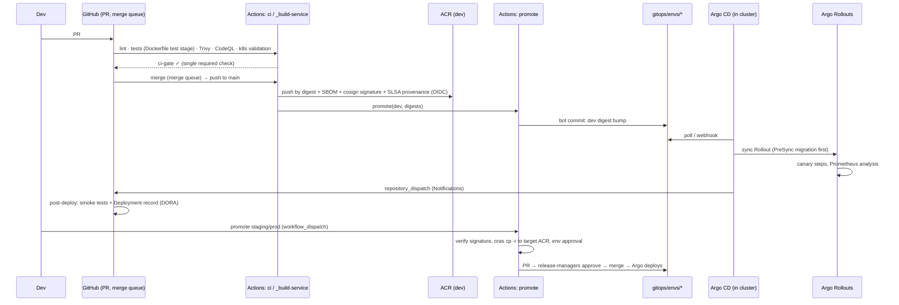

# Architecture & design decisions

## 1. Request path (north-south)

```
browser ─TLS─▶ Azure Front Door Premium (anycast, WAF: OWASP DRS 2.1 + bot rules + rate limit)
        ─Private Link─▶ Private Link Service (snet-pls) ─▶ internal Azure Standard LB (static IP)
        ─▶ Istio Gateway pods (Gateway API, HPA 3..15, PDB)  ── JWT validated here (RequestAuthentication)
        ─HTTPRoute─▶ <svc>-stable / <svc>-canary Services ─mTLS─▶ pods
```

* **No public IP on the cluster.** AKS creates the internal LB *and* the PLS from
  annotations on the gateway Service (`spec.infrastructure.annotations` on the Gateway).
  Front Door is the only way in, so WAF can't be bypassed.
* **Gateway API instead of ingress-nginx.** The community ingress-nginx controller was
  retired in March 2026. Gateway API gives typed routing, and the roles split cleanly:
  the platform team owns the `Gateway`, app teams own `HTTPRoute`s.
* **"API gateway" duties are layered:** Front Door handles TLS, WAF, rate limits and geo.
  The Istio Gateway handles JWT auth, routing, timeouts and retries. Azure API Management
  would be added for partner APIs (keys, quotas, developer portal); a storefront doesn't need it.

## 2. East-west (service mesh)

* Istio sidecars run in **native sidecar** mode (`ENABLE_NATIVE_SIDECARS`), so Jobs
  complete and startup/shutdown ordering is correct. **istio-cni** removes the privileged
  init container, so app namespaces can enforce Pod Security **restricted**.
* **Zero trust:** mesh-wide `PeerAuthentication STRICT`, an `allow-nothing` baseline, and a
  per-service `AuthorizationPolicy` that lists the SPIFFE identities allowed to call it.
  A Cilium `NetworkPolicy` underneath does the same at L3/L4 as defence in depth.
* **Egress is REGISTRY_ONLY:** only in-mesh hosts and `ServiceEntry`-registered Azure PaaS
  hosts are reachable.
* **Resilience:** HTTPRoute timeouts, a `DestinationRule` per backend (connection pools,
  outlier detection = passive circuit breaking, LEAST_REQUEST), and idempotency keys where
  retries could double-charge.
* **One HTTPRoute serves both directions.** Its parents are the edge Gateway *and* the
  Service itself (Gateway API "GAMMA" mesh mode), so canary weights apply to edge and
  in-mesh traffic alike.

## 3. Progressive delivery

| | canary (most services) | blue-green (payment) | rolling (recommendation, notification) |
|---|---|---|---|
| traffic | 10→25→50→100% via HTTPRoute weights | atomic switch of the active Service selector | pod-by-pod |
| gate | background analysis: success rate ≥99%, p95 ≤500 ms (Istio metrics) | pre-promotion smoke Job on the preview Service, **manual promote**, post-promotion analysis | readiness probes |
| rollback | automatic on 2 failed measurements | automatic during post-promotion; blue kept warm for 10 min | `kubectl rollout undo` / revert |
| why | gradual blast radius | never mix versions while money moves | low risk, cheapest |

Argo CD is told to `ignoreDifferences` on HTTPRoute weights and Rollouts-managed
Service selectors. Otherwise self-heal would fight the canary.

**Database changes** run as an Argo CD `PreSync` Job before the new pods start, and
must be backward compatible (expand → migrate → contract), because old and new pods
serve side by side during a canary.

## 4. Delivery pipeline



Principles:

* **Build once, promote the digest.** Staging and prod run the exact bytes that were tested.
  `oras cp -r` carries the signature, SBOM and provenance with the image.
* **CI never touches the cluster.** Argo CD pulls from inside. The prod API server is
  private and CI holds no kube credentials.
* **No secrets in CI.** Azure access uses OIDC federated credentials bound to a GitHub
  environment. Git writes use a short-lived GitHub App token.
* **Separate identities by duty:** `ci-publish` (AcrPush only), `<env>-plan` (read-only),
  `<env>` (deploy, with approvals). The Terraform identity has *constrained* RBAC Admin
  (ABAC condition) instead of Owner.

## 5. Supply-chain security

| Control | Where |
|---|---|
| SHA-pinned actions, allow-list, Dependabot with cooldown | `.github/`, `stacks/github` |
| CodeQL (Go, JS, Python, Java, **Actions**), dependency review | `security.yml` |
| Secret scanning + push protection | org / `stacks/github` |
| Trivy image + IaC scans → code scanning | `_build-service.yml`, `terraform.yml` |
| SBOM (SPDX), BuildKit provenance, GitHub artifact attestation | `_build-service.yml` |
| Keyless cosign signature bound to the *reusable workflow identity* | `_build-service.yml` |
| Admission: verify signature, digest pinning, allowed registries, requests required | Kyverno policies |
| Runtime: PSA restricted, non-root, RO root FS, drop ALL caps, seccomp | chart defaults |

## 6. Identity & secrets

```
pod SA (shop/order) ──projected token──▶ Entra ID (trusts AKS OIDC issuer)
                    ◀── access token ─── for Service Bus (Data Sender on the topic only)
```

* Workload Identity everywhere (order, notification, KEDA, ESO, cert-manager, Loki).
* Key Vault in RBAC mode, private endpoint. External Secrets syncs into K8s Secrets;
  Reloader restarts pods on rotation.
* Generated DB credentials use Terraform **ephemeral resources + write-only attributes**,
  so the password is never stored in tfstate.

## 7. Infrastructure

* One root module, three `tfvars` and three state files. Each environment lives in its
  own subscription (blast radius, RBAC, cost).
* AKS: Azure CNI Overlay + Cilium, NAT Gateway egress (stable IP, no SNAT exhaustion),
  Entra-only auth with local accounts disabled, a tainted system pool, an autoscaled
  3-zone apps pool, an optional spot pool, managed KEDA and VPA add-ons, patch and
  node-image auto-upgrade in maintenance windows, control-plane logs to Log Analytics.
* Azure Managed Redis is deployed through **AzAPI**, because Azure Cache for Redis is
  retiring and azurerm coverage lags.
* Guard-rails: `prevent_destroy` on the database, validations on inputs, `check` blocks
  for post-apply health, budgets with alerts, nightly drift detection.

## 8. Observability

* **Metrics:** one `PodMonitor` on the sidecars' `:15020` merged endpoint covers Envoy
  golden signals and app metrics without plaintext scraping under STRICT mTLS.
* **SLOs:** every chart release ships multi-window burn-rate alerts (fast burn pages,
  slow burn opens a ticket).
* **Logs:** Grafana Alloy (the Promtail successor) DaemonSet → Loki on Azure Blob
  (workload identity).
* **Traces:** Envoy → OTLP → Alloy → Tempo. Tempo's metrics generator builds the service graph.
* **Delivery metrics:** alerts on Rollout aborts and Argo CD drift/degradation; DORA lead
  time comes from `post-deploy.yml`.

## 9. Known trade-offs / next steps

* One Argo CD per cluster (pull model, simple, isolated) vs a hub Argo CD (one pane, but
  it needs network paths to private clusters). At ~5+ clusters, move to a hub with
  ApplicationSet cluster generators.
* Redis still uses an access key (in Key Vault); next step is Entra auth for cart.
* Order uses synchronous orchestration. The next step is the **outbox pattern** to make
  event publishing transactional.
* FQDN-level egress needs Cilium FQDN policies (ACNS) or Azure Firewall in a hub VNet.
* AKS cluster upgrades across minors can be done **blue-green at cluster level**: build a
  new cluster from the same Git, add it to the Front Door origin group with low weight,
  then shift.
